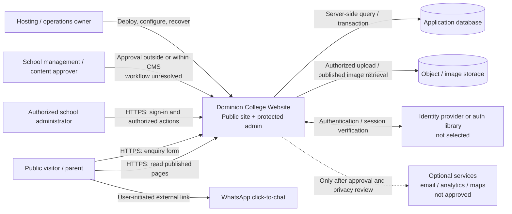
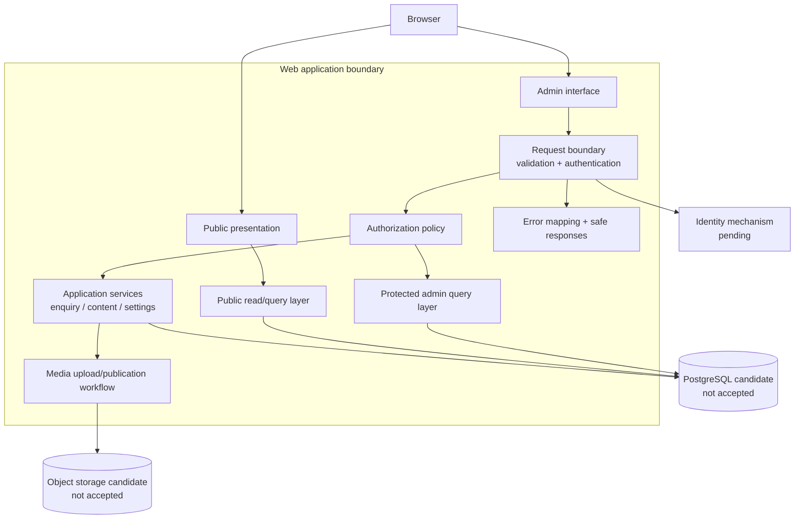
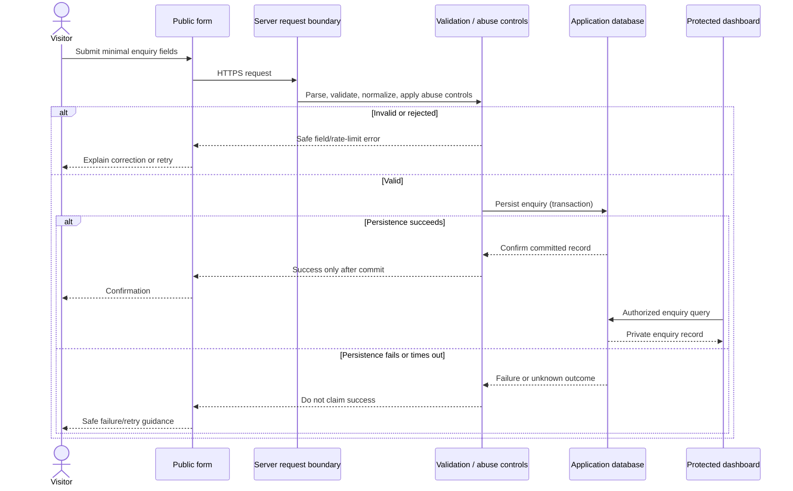

# Dominion College Website Architecture

**Status:** Target architecture; technology and vendor selections remain provisional  
**Last reviewed:** 2026-10-27  
**Authority:** This document defines the intended system boundaries and architecture constraints for implementation. It does not approve any proposed technology, vendor, budget, or unresolved business policy. Changes to the architecture must be reflected here and, for significant decisions, in an approved ADR.

## 1. Purpose and Current State

The target system is the Dominion College public website and protected administration dashboard described in [`../prd.md`](../prd.md). Its purpose is to present school-approved information, support admissions enquiries and WhatsApp contact, and allow authorized staff to manage news, images, selected public content, settings, and enquiry status.

The workspace has no product application code, dependency manifests, implemented database schema, deployment configuration, or accepted ADRs. The proposed logical schema is documented in [`database-schema.md`](./database-schema.md). The `.agents/skills/` directory contains agent tooling rather than application components. Accordingly, this document describes a target system; it does not claim that any component or control has been implemented.

### Authority and decision status

- Product scope, required behavior, and acceptance criteria remain governed by the draft PRD.
- This document is authoritative for the target system boundaries, responsibilities, data flows, and architectural invariants stated as requirements below.
- Technology choices in [`research-and-decisions.md`](./research-and-decisions.md) and [`decisions/`](./decisions/) are **Proposed**, not approved. There are currently no Accepted ADRs. Do not treat proposals here as authorization to choose a vendor, provision accounts, or add dependencies.
- [`security-specification.md`](./security-specification.md) exists as a proposed reference, but the Principal has designated it reference-only pending formal approval. The PRD and AGENTS.md remain governing for applicable security, privacy, and child-protection requirements; do not treat proposed controls as approved policy.
- If an architecture constraint conflicts with product scope, privacy policy, security requirements, or an approved ADR, stop and obtain a decision. Update this document and relevant specifications after approval; do not silently select the easier interpretation.

## 2. System Overview, Scope, and Actors

### In scope for MVP

1. Public pages: Home, About, Academics, Admissions, News listing and article, Gallery, Contact, and Privacy Notice. The custom 404 page is P1.
2. Protected administration: sign-in/session controls, dashboard overview, news management, gallery management, admissions enquiry review/status management, selected editable website content, and approved website settings.
3. Server-side validation and persistence for admissions enquiries and content-management operations.
4. Public rendering of approved/published content only, with SEO metadata and safe empty/error states.
5. Configurable approved contact details and WhatsApp click-to-chat link.

The system is not a student information system, parent/student portal, complete admission application, payment/attendance/results platform, CRM, automated admissions decision-maker, native mobile application, or AI chatbot. These remain outside MVP unless separately approved by a requirements change.

### Actors

| Actor | Trust level and responsibilities |
|---|---|
| Public visitor / prospective parent or guardian | Unauthenticated; reads public content, submits an enquiry, or follows the configured WhatsApp link. |
| School administrator / content manager | Authenticated; may perform only actions authorized by the approved role policy. May manage content and review enquiries as permitted. |
| School management / content approver | Approves institutional claims, policies, contact details, and media publication according to school policy. Approval workflow and role are unresolved. |
| Hosting / operations owner | Controls approved deployment accounts, secrets, backups, monitoring, recovery, and release operations. Owner/provider are unresolved. |
| External services | Selected hosting, database, object storage, identity, and (if separately approved) monitoring/notification providers. No vendor has been accepted. |

### System boundary

The website owns its application-level content, settings, publication state, and enquiry records. It does not own the visitor's WhatsApp account or the delivery/read state of a WhatsApp message. A click-to-chat action transfers the visitor to WhatsApp; the website must not claim message delivery. Optional analytics, email, maps, SMS, marketing scripts, and automated WhatsApp APIs are outside the current integration boundary until approved.

## 3. Architectural Drivers

| Driver | Architectural consequence |
|---|---|
| Admissions usability and discoverability (G1, G5) | Public pages must be directly navigable, mobile-usable, indexable where approved, and separate from private admin data. |
| Verified school content (G2; FR-02, FR-03, FR-08) | Publication is a controlled boundary; missing or pending facts are not rendered as confirmed public content. |
| Independent content management (G4; FR-06–FR-09) | CMS writes use trusted server operations and update public published views without a code deployment. |
| Performance and responsiveness (NFR-01–NFR-02) | Optimize media and public rendering; paginate/limit administrative lists; validate the stated viewports and CWV criteria. Workload and freshness thresholds remain to be set. |
| Reliability and recovery (NFR-06) | Persist an enquiry before acknowledging success; operate backups and test restoration; optional notification failure must not undo saved records. |
| Security (NFR-04) | Authenticate admin users, authorize each protected operation server-side, validate untrusted input, keep secrets off clients, and limit data exposure in logs. |
| Privacy and child protection (NFR-05) | Minimize enquiry fields, restrict private records, require school-authorized student-media publication, and do not send sensitive student/enquiry data to AI providers. Retention and authorization rules require school approval. |
| Accessibility (NFR-03) | Public and admin interfaces target WCAG 2.2 AA with automated and manual keyboard evaluation; conformance evidence and exceptions are not yet specified. |
| Maintainability and cost (G6; NFR-07) | Prefer a coherent application and minimal services. Provider costs, scale, and operational staffing are unknown; avoid premature queues and optional integrations. |
| AI behavior | No runtime AI/model/orchestration is included in MVP. Use of AI tools with non-public school data is subject to approved data policy. |

## 4. System Context and Interactions

### External interaction rules

- Public clients communicate with the web application over HTTPS. They do not receive database credentials, storage credentials, identity-provider secrets, or privileged tokens.
- Only published, school-approved public content is served by public routes.
- Admin routes, mutations, private enquiry records, and unpublished assets require authenticated and server-authorized access.
- WhatsApp is an outbound user-initiated link, not a server-side integration.
- Optional external APIs remain disabled/out of scope until the school approves purpose, data transfer, provider, failure behavior, and privacy review.

## 5. Logical Components and Responsibilities

The components below are logical responsibilities, not a claim that separate services or code modules already exist.

| Component | Responsibility and interfaces | Dependencies | Failure behavior |
|---|---|---|---|
| Public presentation | Render approved school pages, published news/gallery, contact details, metadata, and visitor-facing form states. Reads only public-safe projections. | Public read/query layer; configured site content and media. | Show not-found for invalid article slugs; render clear empty/unavailable states; do not fall back to fabricated content. |
| Admin interface | Provide protected dashboard, content forms, previews, enquiry review, settings, and session controls. | Authentication/session mechanism; authorized server operations. | Never treat hidden UI as authorization. Surface actionable errors without internal details. |
| Request boundary | Accept form and admin requests; parse and validate shape/size; establish trusted identity context; reject malformed requests. | Framework/runtime (pending), identity mechanism, application services. | Reject invalid or unauthenticated requests; return safe error responses and a correlation reference where available. |
| Authorization policy | Enforce user status and permission on every protected read/mutation, including direct requests. | Verified identity and approved role/action policy. | Deny by default when identity or policy cannot be verified; do not proceed on frontend state alone. |
| Application services | Apply business rules for enquiry creation, article/gallery lifecycle, site settings, publication, and authorized status changes. | Authorization policy, data access, media workflow. | Validate before writes; preserve transaction integrity; report persistence failures honestly. |
| Public read/query layer | Retrieve public pages and published articles/images/settings only; support pagination and stable slugs. | Database and published media storage. | Exclude drafts/unpublished content by construction; return empty/not-found/error state rather than private or stale unauthorized data. |
| Protected admin query layer | Retrieve private enquiries and draft/admin data for authorized staff; calculate dashboard counts from persisted records. | Authorization policy and database. | Fail closed if access checks or data service are unavailable; never expose records publicly or use hardcoded statistics. |
| Media upload/publication workflow | Validate permitted image inputs and metadata, store media, manage publication state, and serve optimized renditions as approved. | Object storage and database metadata. | Do not publish partially processed or unapproved assets; failed upload leaves no public reference. Exact size/type limits and processing approach require decisions. |
| Error mapping and observability | Convert expected validation, authorization, not-found, conflict, and dependency failures to safe user-facing responses; record operational events without sensitive payloads. | Application components and selected monitoring/logging service (pending). | Preserve diagnostic context without logging secrets, full enquiry content, or unnecessary child/personal data. Monitoring provider and retention are unresolved. |

## 6. Data Model and Data Flows

### Conceptual data ownership

The PRD proposes these records; this architecture does not define final fields, schema, retention, or migrations:

- **AdminUser / identity reference:** identity and active status; credentials may be external. Never store plain-text passwords.
- **NewsArticle:** title, slug, body/summary, image reference, SEO metadata, author, timestamps, publication status/date.
- **GalleryAlbum and GalleryImage:** grouping, storage reference, caption/alt text, ordering, status, uploader, and creation time.
- **AdmissionsEnquiry:** parent/guardian name, phone, optional email, entry level, optional message, status, timestamps, and optional assignment. This is private personal data.
- **SiteSettings:** approved public school details and contact/social/SEO configuration. Must not contain infrastructure secrets.

Database constraints, allowed status transitions, audit history, retention, and deletion rules require a schema and policy decision before implementation. Published article/image status is a security/publication boundary, not just a visual label.

### Enquiry submission

Flow requirements:

1. Collect only PRD-approved fields; do not request student identity documents, medical data, or other unnecessary sensitive information.
2. Client validation improves usability only. The server validates required fields, contact data, entry-level options, and configured payload size limits.
3. Apply abuse controls at the server boundary. Exact thresholds and duplicate/idempotency behavior remain unresolved; do not claim duplicate prevention until defined and tested.
4. Commit the enquiry before showing success. The write and any required related state changes must be atomic. If persistence outcome is uncertain after a timeout, do not report success; duplicate-safe retry semantics need an owner decision.
5. A stored enquiry is visible only to authorized dashboard users. It must not be included in public responses, URLs, analytics events, or logs.
6. Email notifications are optional and not in the MVP baseline. If separately approved, notification failure must not roll back an enquiry; durable retry, idempotency, delivery visibility, provider, and data payload require a separate design.

### Content and settings flow

1. An authorized administrator creates or edits content in the protected interface.
2. The server validates input and permission; rich text is sanitized before public rendering (FR-06).
3. Images are treated as untrusted uploads: validate actual file content and configured size/type limits, store outside public application code, and do not expose until approved and published.
4. School approval for institutional facts and identifiable student photographs is required by the PRD. The mechanism/evidence and role are unresolved. When approval cannot be established, the item remains unpublished.
5. Publication writes status and content metadata atomically. Public reads query only published records. Changes should become visible without redeployment; exact cache invalidation/freshness target remains open.
6. Unpublish/removal disables public retrieval. The school must decide handling of CDN/browser copies and external copies of already-public images.

### Logging and external transfers

- Operational logs may capture event type, safe error classification, timestamp, and a non-sensitive correlation identifier where supported.
- Do not log passwords, tokens, database/storage credentials, full enquiry messages/contact fields, private image URLs, or student-identifying metadata unless a separately approved policy demonstrates necessity and safeguards.
- WhatsApp receives the visitor's navigation to its click-to-chat service and any message the visitor chooses to send. The website cannot verify delivery/read state.
- No analytics, AI, maps, email/SMS, advertising, or other third-party transfer is assumed. Any addition requires privacy, security, and business approval with its data flow recorded here and in the security/privacy documents.

## 7. Interaction, Caching, and Consistency Patterns

- **Synchronous web requests:** Public reads, login/session checks, content mutations, and enquiry persistence are request/response operations in the target design. Visitors receive success only after the relevant persistent action succeeds.
- **Transactions:** Enquiry creation and content publication must not expose partial application state. Use database transactions where multiple database records must change together. Object storage and database are separate systems; no distributed transaction is assumed. Failed media workflows must not leave a publicly visible database reference to an incomplete/unapproved asset.
- **Asynchronous work:** No queue, scheduled worker, AI orchestration, or background processing is required by the approved MVP scope as written. Do not add one without a justified requirement and ADR.
- **Retries/idempotency:** Retryable writes must be reviewed for duplicate effects. Enquiry duplicate/idempotency behavior is open. Do not blindly retry mutations or assert exactly-once delivery.
- **Caching:** Public published content may be cached only if publication/unpublish changes propagate according to an approved freshness objective. Private dashboard data, sessions, and enquiries must never enter shared/public caches. Unknown authentication or authorization must fail closed.
- **Pagination:** News and enquiry lists should be bounded/paginated as required by NFR-01. Exact page sizes and expected data volume are not yet set.
- **Events:** No event bus or domain-event platform is needed for the current MVP. A future requirement for durable notifications or integrations should introduce explicit event ownership, payload minimization, delivery/retry semantics, and monitoring.

## 8. Security, Identity, and Privacy Boundaries

### Trust boundaries

1. **Untrusted browser to web application:** all fields, URLs, IDs, files, and client-side state are untrusted. Validate and authorize server-side.
2. **Web application to identity service:** identity assertion/session integrity and provider secrets must be verified server-side. Authentication does not grant authorization by itself.
3. **Application to database:** only trusted server code may use privileged credentials. Use least privilege, encrypted transport, migrations, constraints, and protected network access where supported.
4. **Application to object storage:** uploads and reads require explicit policies. Keep drafts/unapproved material private; only approved public renditions may be publicly retrievable.
5. **Application to logs/monitoring:** send only minimized operational data; control access and retention. Provider and policy remain pending.
6. **Public content to school/community:** publication is an irreversible disclosure risk, particularly for minors. Require approved content and image permission before public availability.

### Required invariants

- Every protected route, query, mutation, and media operation enforces server-side authentication and authorization.
- Unauthenticated, inactive, or unauthorized users cannot access private records or perform privileged actions.
- Public content endpoints expose only approved, published data; drafts and unapproved assets remain inaccessible even with guessed URLs/IDs.
- Secrets are supplied through protected environment/platform configuration, never committed or returned to clients.
- Input is validated at trust boundaries; rich text and uploaded files are handled as untrusted.
- Errors do not expose stack traces, credentials, private records, or internal infrastructure details.
- Enquiry data is minimized and access-limited; approved retention/deletion controls must be implemented before production use.
- AI runtime features are absent from MVP. Sensitive student information must not be provided to third-party AI services (PRD NFR-05).

Detailed identity policy, role matrix, security control mapping, incident process, retention, privacy notice, media authorization evidence, and threat model belong in `security-specification.md` and require school approval. That document is not present at this time. See audit findings AUD-03–AUD-08 and the proposed authentication ADR.

## 9. Deployment Units, Runtime, and Configuration

### Logical deployment units

The target has the following logical units; actual hosting topology is not approved:

1. **Web application:** public rendering, dashboard, request boundary, application services, and server-side data access. Proposed stack is TypeScript/Next.js/React (ADR-001 Proposed).
2. **Relational database:** proposed PostgreSQL for application records (ADR-002 Proposed).
3. **Object storage:** proposed managed storage for uploaded originals/renditions and publication-controlled media (ADR-004 Proposed).
4. **Identity mechanism:** established authentication library or identity provider (ADR-003 Proposed).
5. **Optional operational services:** monitoring, notification, analytics, or CDN services only after approval; none is selected.

The web application may be deployed as one managed application or self-hosted runtime after provider constraints are approved. Database and storage must not rely on ephemeral application-local files for durable production data.

### Environments and configuration

- Separate local development, test/CI, staging, and production configuration and data. Never copy production enquiry/student data into development or test without explicit authorization and safeguards.
- Keep secrets in the selected hosting secret manager or protected environment configuration. `.env.example` may document names and formats only; it must contain no real secrets.
- Validate required configuration at startup/deployment and fail explicitly for missing critical values. A missing WhatsApp number must not produce a guessed contact link.
- Apply schema changes through reviewed migrations. Production migration and rollback procedures must be documented and tested before launch.
- Use HTTPS for production. Restrict database/storage administrative access and provider accounts to named owners with least privilege.
- Configure backups, restoration, monitoring, DNS/domain, and deployment rollback as production operations. Providers, regions, RTO/RPO, retention, and owners remain unresolved.

Exact runtime versions, package versions, vendor limits, region, network rules, deployment commands, and CI/CD system must be documented after ADR decisions and verified against current vendor documentation. No such setup currently exists.

## 10. Failure and Recovery Behavior

| Failure | Required system behavior | Recovery/operational concern |
|---|---|---|
| Invalid form/admin input | Reject at server boundary; return actionable validation feedback; do not persist invalid state. | Validation rules and limits must be tested. |
| Unauthenticated/unauthorized request | Deny; do not return protected data. | Record a minimized security event if policy permits; avoid leaking whether sensitive records exist. |
| Database unavailable or write fails | Do not show enquiry/content success; return safe failure. Keep existing data unchanged where transaction semantics apply. | Alert/diagnose through approved telemetry; retry only with defined idempotency. |
| Database timeout with unknown write outcome | Do not falsely claim failure or success; show safe retry guidance and prevent unsafe duplicate effects once policy is defined. | Define idempotency strategy and operator reconciliation. |
| Object storage unavailable/upload rejected | Keep asset unpublished; report failure; do not create a public reference to incomplete media. | Retry/replacement procedure and orphan cleanup policy require implementation design. |
| Invalid/malicious upload | Reject based on server-side validation; never serve raw rejected file publicly. | Record safe reason without storing sensitive content in logs. |
| Identity provider unavailable/session invalid | Fail closed for admin access; public pages may continue only if independent of private identity service. | Recovery/support channel and session behavior must be selected. |
| Optional notification failure | Preserve committed enquiry and report notification failure to operations if notification is approved. | Retry/queue/delivery status only if separately specified. |
| Published content cache stale | Avoid exposing unpublished or private data; invalidate/refresh public content according to a future measurable freshness target. | Current PRD says promptly but does not define a duration. |
| Invalid/missing article slug | Return a proper not-found response, not draft content (FR-06). | Ensure no private preview leaks through alternate route. |
| Application deployment/migration failure | Do not direct traffic to an unhealthy release; use approved rollback/forward-recovery procedure. | Deployment platform and migration compatibility strategy remain to be selected. |
| Backup restore required | Restore to an approved environment, validate integrity, record restoration evidence, and follow approved data access process. | RTO/RPO, backup retention, and recovery owner need human approval. |

## 11. Approved and Proposed Technology

There are **no accepted ADRs** and no implementation stack. The following is a proposal register, not an approved stack:

| Technology/responsibility | Status | Reference |
|---|---|---|
| TypeScript + Next.js App Router / React | Proposed baseline; owner approval required | [ADR-001](./decisions/ADR-001-typescript-nextjs.md) |
| Node.js runtime | Version to be selected within the approved framework and LTS support window; not yet selected | [ADR-001](./decisions/ADR-001-typescript-nextjs.md) |
| PostgreSQL | Proposed relational database; provider/version/region pending | [ADR-002](./decisions/ADR-002-postgresql-data-platform.md) |
| ORM/query layer | Not selected; compare after runtime, team, migrations, and pooling are known | [ADR-002](./decisions/ADR-002-postgresql-data-platform.md) |
| Authentication library or managed identity provider | Proposed use of established solution; provider and account policy pending | [ADR-003](./decisions/ADR-003-administrator-authentication.md) |
| Managed hosting and object storage | Direction proposed if privacy, budget, region, and ownership fit; no vendor approved | [ADR-004](./decisions/ADR-004-hosting-and-media-storage.md) |
| Queue/background worker | Not required for current MVP; add only for an approved asynchronous workload | [research-and-decisions.md](./research-and-decisions.md) |
| WhatsApp Business API, analytics, email/SMS, maps, AI provider | Not selected; automated/API integrations are not part of current baseline | [research-and-decisions.md](./research-and-decisions.md) |
| Monitoring provider and test runner | Requirements described; provider/tool selection pending | [research-and-decisions.md](./research-and-decisions.md) |

## 12. Trade-offs and Limitations

- A single application boundary avoids unnecessary distributed systems for the current website and CMS, but creates a need for disciplined server/client separation and route-level authorization.
- Relational storage fits the entities and constraints in the PRD. It introduces database operations, migrations, credentials, backups, and provider selection.
- Managed hosting/storage may reduce operational burden but creates vendor, region, data-processing, availability, and cost dependencies. Self-hosting would transfer more operational responsibility to the school.
- Server-rendered/cached public pages can support discoverability and performance, while private dashboard data must remain uncached and access-controlled. Exact freshness targets are unresolved.
- A minimal synchronous enquiry flow avoids queue complexity but leaves duplicate/retry semantics and optional notification delivery to be specified if they become requirements.
- Image publication offers useful school context but creates child-safety and revocation risks; system removal cannot guarantee deletion of copies already downloaded, cached, or shared externally.
- This architecture is not a threat model, deployment runbook, final database schema, API contract, privacy notice, or accessibility certification. Those require follow-up specifications and owner review.

## 13. Traceability

| Architecture area | Requirement trace |
|---|---|
| Public/admin system boundary and page responsibilities | PRD §4.1–4.2, FR-01–FR-10, G1–G6 |
| Admissions request and persistence flow | FR-04, §6.3, AdmissionsEnquiry in §8.2, NFR-04–NFR-06 |
| WhatsApp external interaction | FR-05, FR-08 |
| Published news and safe rich-text rendering | FR-06, FR-10, NFR-04, NFR-08 |
| Gallery/media workflow and student protection | FR-07, NFR-04–NFR-05, §12 |
| Admin identity, authorization, and private records | FR-09, NFR-04–NFR-05, §14.2 |
| Data entities, integrity, migrations, and retention | §8.2–8.3, NFR-06–NFR-07 |
| Performance, responsive behavior, accessibility | NFR-01–NFR-03; §10.3–10.4; §14.3 |
| SEO, public indexing, and private exclusion | FR-10, NFR-08 |
| Logging, backups, failure handling, and operations | NFR-04, NFR-06; §14–15, §17–18 |
| AI and external data handling | §2.2 non-goals, NFR-05 |
| Deployment, rollback, and handover | §15, §17–18 |

No separate task IDs exist in the current project materials; requirement IDs above provide the available traceability.

## 14. Unresolved Questions and Approval Gates

Before finalizing implementation design or production operations, obtain decisions on:

1. **Technology:** accept/reject ADR-001 and ADR-002; select runtime/framework versions, database provider/region, and data-access layer.
2. **Identity:** accept/reject ADR-003; define admin roles/actions, MFA, bootstrap, recovery, disablement, and access review.
3. **Hosting:** accept/reject ADR-004; choose domain, hosting, storage, account owner, budget, region/data processing, and support model.
4. **Privacy and security:** approve purpose/notice/retention/deletion, enquiry access, image permission evidence/revocation, breach handling, and security verification. Resolve audit findings AUD-03–AUD-08.
5. **Publication:** define who approves school facts and student images, which fields are editable, and whether preview can expose drafts outside authenticated access.
6. **Reliability:** set expected traffic/media volumes, public content freshness, backup retention, RTO/RPO, alert owner, and incident escalation.
7. **Integrations:** decide whether email notification or analytics is required; approve data flows/providers for any optional API. Confirm the verified WhatsApp number outside this architecture document.
8. **Operational acceptance:** define testing evidence, accessibility exceptions, launch gates, deployment approval, and migration rollback.
9. **AI-assisted development:** approve permitted data classes for coding tools; no runtime AI capability is proposed.

Until approved, these are open decisions. They must not be filled with guessed values or treated as implied acceptance of a vendor or architecture proposal.
