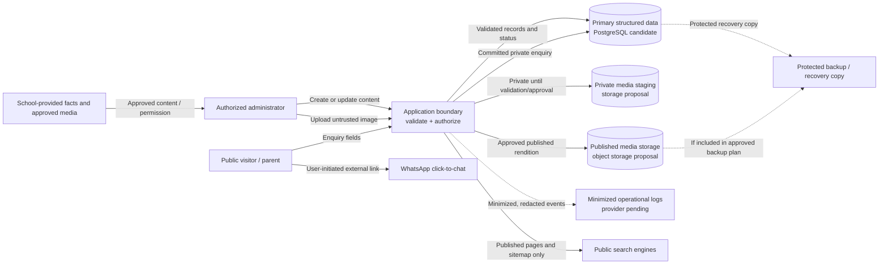

# Data Architecture

**Status:** Target data architecture; persistence technologies, policies, and schema are not approved  
**Last reviewed:** 2026-10-27  
**Authority:** This document defines data ownership, flows, and mandatory handling constraints for the target system. Product scope and fields remain governed by the draft [`../prd.md`](../prd.md). A proposed logical schema and proposed security reference exist, but no implemented schema, source code, database, or accepted ADR exists in the workspace. The security specification is reference-only pending formal approval.

## 1. Scope and Decision Status

The target system stores school-approved public content and settings, administrator identity references, gallery media metadata, and private admissions enquiries. Its MVP includes public pages and a protected content-management dashboard; it is not an admissions application or student information system.

The PRD proposes PostgreSQL for structured records and managed object storage for images. The research record and [ADR-002](./decisions/ADR-002-postgresql-data-platform.md) and [ADR-004](./decisions/ADR-004-hosting-and-media-storage.md) are **Proposed**, not Accepted. No provider, region, ORM, schema, retention period, backup schedule, or production topology is selected. This document must not be used to provision services or collect production data.

The separate [`database-schema.md`](./database-schema.md) and [`security-specification.md`](./security-specification.md) documents are present as proposals. Per the Principal's decision, the security specification is reference-only pending formal approval. High-risk data decisions—including enquiry retention, administrator access, student-image authorization, deletion, and data residency—require school approval before production use.

## 2. Data Inventory and Ownership

Sensitivity labels below describe intended handling, not a formal school classification scheme. Ownership identifies the authoritative source; the application is not the authority for whether school facts or media permissions are true.

| Category / candidate entity | Purpose and source | Consumers | Sensitivity | Business owner / authoritative source | Proposed storage role | Retention |
|---|---|---|---|---|---|---|
| Institutional copy and academic/admissions information | Public pages; entered or supplied by school representatives and approved by school management. | Public website; authorized editors. | Public only after approval; pending material is restricted. | School management is authoritative for approved facts; CMS is the current published copy. | Primary application record proposed in relational database or an approved content representation. | Active while approved/current; archive and removal rules are TBD. |
| News articles and SEO fields (`NewsArticle`) | Created/edited by authorized staff; title, body, slug, publication state/date, image reference, metadata. | Public pages receive published projection; admins receive drafts and management views. | Public when published; draft/unpublished content is restricted. | School/content approver for truth and approval; application record is authoritative for current publication state. | Primary structured content record; media bytes stored separately. | Publication/archive/deletion duration and version history are TBD. |
| Gallery albums and image metadata (`GalleryAlbum`, `GalleryImage`) | Admin-provided title, caption, alt text, order, album, status, uploader, storage reference. | Public gallery receives approved/published items; admins manage all authorized items. | Metadata may identify people; unpublished items and permission evidence are restricted. | School owns media and approval; application record controls publication state; storage owns binary bytes. | Relational metadata plus object/file storage proposed; private upload staging until approved. | Media retention, authorization evidence duration, and purge behavior are TBD. |
| Student photographs / identifiable media | Supplied by school or authorized staff; publication requires school authorization. | Public visitors only for approved/published rendition; authorized admins for management. | Sensitive due to minors and identifying imagery. | School is authoritative for permission and allowed use; application status alone is not proof of permission unless an approved workflow records it. | Private object storage until approval; only explicitly approved rendition may be publicly served. | School must define permission scope, retention, withdrawal, and purge policy. |
| Admissions enquiries (`AdmissionsEnquiry`) | Submitted by parent/guardian through public form. PRD fields: name, phone, optional email, entry level, optional message, status, timestamps, optional assignee. | Authorized admissions/admin staff only. | Personal information; message may contain excess sensitive details despite form guidance. | School owns the response and retention purpose; application database is the authoritative enquiry record. | Primary private structured record in relational database proposed. Never public or analytics data. | Explicit school-approved retention/deletion period required before production. |
| Administrator identity and authorization reference (`AdminUser`) | Provisioned by approved account owner or identity provider; active status and role/reference. | Authentication and authorization services; minimal admin UI profile. | Restricted account/security data. | Approved identity provider or account owner is authoritative for identity; application policy controls local role/active access where applicable. | Identity provider or restricted user table; provider not selected. | Account retention/deactivation policy TBD; disable access promptly on departure. |
| Site settings and contact configuration (`SiteSettings`) | Entered/approved by school: official name, logo reference, colors, phone, WhatsApp, approved address, social links, SEO defaults. | Public pages read approved public subset; admins update permitted settings. | Public after approval; drafts/restricted settings limited to admins. | School management is authoritative; CMS stores configured values. | Structured application records or validated configuration; exact editable/static split TBD. | Retain current values while in use; change history/retention TBD. |
| Application configuration and secrets | Created/managed by deployment/account owners, not entered as CMS content. | Server runtime and authorized operators only. | Secret / highly restricted. | Hosting or secret-management control plane, not application database or `SiteSettings`. | Protected runtime configuration/secret manager; provider not selected. | Rotate/revoke under approved operational policy; never place in public settings or source control. |
| Operational logs and security events | Generated by application/runtime for fault diagnosis and security monitoring. | Authorized operators; monitoring provider if approved. | Minimized operational data; may become sensitive if poorly designed. | Runtime is source; approved monitoring/log service is a copy/consumer. | Log/monitoring system only if selected; not a record store. | Retention and access policy TBD; minimize and redact by design. |
| Backups and recovery copies | Generated by database/storage operations. | Authorized operators for recovery only. | Same or greater sensitivity as source data. | Backup system is a recovery copy; live authoritative record remains the source system. | Provider-managed or approved backup target, not selected. | Retention, encryption, region, and RPO/RTO TBD; restore must be tested. |
| Temporary upload data | Created during media upload/validation/processing. | Media workflow only; authorized admin as needed. | Restricted until approved. | Temporary workflow is not authoritative; final metadata/state and approved object are authoritative. | Ephemeral private staging or private object prefix; technology/cleanup not selected. | Delete after success/failure according to approved cleanup policy; bounded lifecycle required. |

### Non-required data stores

- **Search service/index:** no separate search engine is justified. Public search-engine indexing uses published website pages and sitemap (FR-10); an internal CMS search is not specified.
- **Analytics/event store:** analytics is optional and unapproved. Do not collect enquiry content, contact fields, student details, or private identifiers in analytics.
- **Vector database/embeddings:** no AI runtime or semantic search use case is in MVP; no vector storage is justified.
- **Queue/event store:** no approved asynchronous workload exists; do not introduce queue persistence pre-emptively.
- **Client-side persistent store:** do not persist enquiries, admin records, session secrets, or privileged data in browser storage unless a separately reviewed need and threat model approve it.

## 3. Data Flow and Lifecycle

### Lifecycle by category

| Stage | Public content and settings | Enquiries | Media |
|---|---|---|---|
| Collection | School supplies facts; authorized staff enter/edit. Content is tagged operationally as verified, pending approval, placeholder, or optional per PRD §8.1. | Visitor submits only the minimum defined form fields. No documents, medical data, or sensitive student details are requested. | Admin uploads school-provided image and descriptive metadata. Permission is confirmed by school process before identifiable student images are published. |
| Validation | Server validates required fields, slug uniqueness, lengths, status and metadata; school approval is a separate business assertion. | Client checks are advisory; server validates required fields, contact format, approved entry-level values, and payload size. Abuse controls apply at trusted boundary. | Server validates actual type/content, size, metadata and access; reject unsafe or unsupported files. Exact allowed limits remain to be set. |
| Transformation | Sanitize rich text before rendering; normalize slugs and dates/timezone according to an approved policy. | Normalize contact details only as necessary to respond; avoid storing unnecessary derived copies. | Strip unnecessary metadata and generate optimized renditions if approved implementation supports it. Keep staging private. |
| Processing | Save draft/update via authorized service; publication is explicit and must not require code deployment. | Persist transactionally; acknowledge success only after confirmed commit. | Persist bytes and metadata without a public reference until validation, approval, and publication are consistent. |
| Storage | Primary structured store; current published state is authoritative. | Primary private store with least-privilege access. | Binary object store plus metadata/reference in primary structured store. |
| Retrieval | Public read model returns approved, published content only; admin views can retrieve permitted drafts. | Authorized dashboard only; no public endpoint, URL, cache, analytics event, or log may expose record fields. | Public retrieval only for published approved renditions; private original/staging remains restricted. |
| Sharing | Published content may be indexed by search engines; only approved claims are eligible. | No sharing to analytics or external APIs by default. School staff may use contact details to respond under approved policy. | Publicly published images may be downloaded, cached, or reshared; removal cannot guarantee deletion of external copies. |
| Archive/deletion | Archive/unpublish according to approved editorial policy. Keep historical versions only if required and approved. | Delete/anonymize on the approved retention schedule and valid operational requests; do not invent duration. | Remove public availability first, purge stored variants and temporary copies according to approved policy, account for backups and caches. |

### Collection and validation boundary

- All browser input is untrusted. Validation on the client is for usability; server validation is authoritative.
- Reject unknown or malformed fields rather than silently persisting them. Enforce configured maximum lengths and request/upload sizes.
- Never infer missing school facts, contact values, admission requirements, permission, or policy from public speculation.
- Treat user-entered messages as potentially containing more personal or sensitive information than requested. Restrict access and avoid logging or onward processing.

## 4. Authoritative Sources and Consistency

1. **School facts and approvals:** School management is authoritative for public claims, contact information, admissions details, policy, and image permission. Application state records the approved/published copy; the system cannot independently prove the truth or permission unless the school adopts an evidence workflow.
2. **Publication state:** The application’s primary content record is authoritative for whether an item is draft, published, unpublished, or archived. Public queries must apply that state on the server.
3. **Enquiry record:** The application’s primary data store is the sole system of record for web enquiries. Notifications, if later approved, are delivery side effects and not alternate authoritative copies.
4. **Media bytes:** The selected object store is authoritative for image bytes; database metadata/reference and publication state govern application discovery and visibility.
5. **Identity:** If a managed provider is selected, it is authoritative for authentication identity; application role/active state may remain local according to the final authorization design.
6. **Settings:** The approved school setting entered through authorized workflow is authoritative within the application. Infrastructure secrets are not site settings.
7. **Backups, caches, logs, analytics:** These are copies or operational projections, never the source of truth. Analytics is not selected.

No synchronization/import/export integration is required by the current MVP beyond staff entering approved content and visitors submitting enquiries. Any export/import or external synchronization needs an owner, schema mapping, access control, data minimization, failure/duplicate policy, and approval before implementation.

## 5. Data Quality, Integrity, and Normalization

- Enforce required fields, unique public slugs, foreign keys/referential integrity, valid status values, and useful query indexes at the authoritative data boundary.
- Validate on the server and apply database constraints as a second integrity barrier. UI constraints alone are insufficient.
- Define and validate state transitions for news, gallery items, and enquiries before implementing mutations. Current enquiry statuses are New, Contacted, Resolved, and Archived; transition rules remain unresolved.
- Store publication timestamps consistently. The PRD requires one configured timezone, but timezone choice and daylight-saving interpretation need confirmation.
- Keep media bytes separate from relational metadata. Avoid duplicating public content into a second editable store.
- Use stable, readable slugs; changing a published slug requires an approved redirect/canonical policy not yet specified.
- Avoid hardcoded dashboard counts; compute from authoritative records and label metrics according to agreed definitions.
- Define duplicate enquiry semantics, retry/idempotency behavior, and conflict handling before claiming duplicate prevention.
- Define whether historical content versions, audit history, or approval evidence are required before final schema design. These affect retention and privacy.

## 6. Privacy, Security, Retention, and Deletion

### Access and exposure

- Enquiries, administrator records, drafts, unapproved media, and private originals are restricted to authenticated and authorized users. Authorization is enforced server-side for every read and write.
- Public content responses use a public-safe projection; never serialize private fields and rely on UI hiding.
- Shared/public caches may contain only approved public content. Private records, admin responses, sessions, and drafts must be excluded.
- Secrets are held in protected runtime/platform configuration, not the database’s public settings, source, logs, or browser.
- Do not include enquiry content/contact data or student identifiers in URLs, analytics, telemetry, or error messages.

### Retention, redaction, and deletion

- Enquiry retention duration, deletion/anonymization procedure, request handling, and lawful/operational exceptions are **not established**. Obtain school approval before accepting production enquiries.
- Identifiable student-image authorization evidence, its scope/expiry, withdrawal workflow, media retention, and purge expectations are **not established**. Unapproved media must remain unpublished.
- Logs must omit passwords, tokens, credentials, full enquiries, contact fields, private image URLs, and student-identifying metadata unless a separately approved policy demonstrates necessity and safeguards.
- Deletion must consider primary records, object variants, temporary upload copies, search-index visibility, caches, exports, and backups. A system deletion cannot guarantee erasure of third-party copies already downloaded or shared.
- Backups contain data at least as sensitive as their source. Restrict access, protect copies, define retention and region, and validate restoration; all detailed settings remain pending.
- Privacy notice, consent/acknowledgement wording, access audience, incident escalation, and applicable compliance review require school approval. This document is not legal advice or a compliance claim.

## 7. Storage Roles

Only stores needed by the product are described. The options below are candidates, not approved infrastructure.

| Store | Role and allowed content | Status |
|---|---|---|
| Primary structured database | Authoritative content metadata, publication state, settings, identity/role reference as appropriate, and private enquiries. Relational integrity and migrations required. | PostgreSQL is proposed in ADR-002; provider, region, version, and data-access layer are undecided. |
| Object/file storage | Image bytes, private upload staging, and explicitly published image renditions. Media metadata/reference remains in primary data store. | Managed object storage is proposed in ADR-004; provider, bucket policy, public/private delivery and backup scope are undecided. |
| Temporary storage | Short-lived validated upload staging only if required by selected upload/processing design. Must not be authoritative or publicly readable. | Role required if implementation uses staged upload; implementation and cleanup policy pending. |
| Cache/CDN | Optional acceleration for public approved pages/media only. Must not cache private/admin data and must respect unpublish/removal behavior. | Provider and freshness objective undecided; correctness takes precedence until defined. |
| Search index | No internal search service is required. Search-engine sitemap/indexing concerns are served from approved public pages only. | No separate search store approved or justified. |
| Analytics/event store | No analytics store or provider approved. Do not collect personal enquiry data or student identifiers as events. | Optional only after privacy/business approval. |
| Queue/event store | No queue or event bus is needed for current synchronous MVP. | Not selected or justified; add only for approved asynchronous requirement. |
| Vector store | No embeddings or semantic retrieval use case exists. | Not needed; no AI runtime in MVP. |
| Browser storage | No authoritative data storage. Avoid retaining private records or credentials in persistent client storage absent a reviewed need. | No browser-side data store approved. |
| Logs and backups | Operational diagnostics and recovery copies, not application records or alternate truth. Must have access and retention controls. | Provider and policies pending. |

## 8. Imports, Exports, and External Data Transfers

- **Imports:** Initial school copy, settings, and images may be manually entered/uploaded by authorized staff. A bulk import mechanism is not specified; if proposed, require source inventory, approval, validation, duplicate handling, preview, and rollback plan.
- **Exports:** No enquiry/content export is specified for MVP. If required, define who may export, minimum fields, format, encryption, delivery, audit, retention, and deletion of exported copies.
- **Synchronization:** No CRM, SIS, admissions platform, or external identity synchronization is approved.
- **WhatsApp:** Public visitor follows a configured click-to-chat link. Any text sent is initiated by the visitor; the website does not receive reliable delivery/read confirmation and must not claim it.
- **Optional notifications/analytics/maps/SMS:** Not in baseline. A future integration must document exact fields transferred, purpose, provider/region, retention, consent/privacy implications, credentials, timeout/retry behavior, and support owner.
- **AI:** No runtime AI provider/model or orchestration. Do not upload student or enquiry information to third-party AI services. Coding-agent access to non-public project data remains subject to approved data policy.

## 9. Schema Evolution, Migrations, Backup, and Recovery

No database schema or migration files exist. Before production data is collected:

1. Define final entities, constraints, relationships, indexes, status transitions, retention/deletion, and audit requirements in an approved schema specification.
2. Version schema changes as reviewed migrations. Validate migrations against a disposable/test database and representative data before release.
3. Document application/schema compatibility for deployment. Prefer expand/contract changes when old and new application versions may overlap; do not assume destructive rollback is safe.
4. For destructive or lossy changes, require explicit approval, backup/recovery plan, data transformation validation, and forward-recovery strategy. A migration rollback cannot always restore deleted/transformed data.
5. Prevent production traffic from using an application incompatible with the active schema; migration and application release sequence depends on the selected platform.
6. Define backup coverage for database records and required media objects, including retention, encryption, access, location, and consistency strategy.
7. Test restoration into an approved isolated environment and verify record/media integrity. A backup job without a successful restore exercise is not evidence of recoverability.
8. Set RTO/RPO, restore owner, backup retention, and incident escalation with the school/operations owner. These values are not supplied and must not be guessed.

## 10. Data Observability and Integrity Monitoring

- Report failures by safe category and operation type (for example validation rejection, database unavailable, media upload failure, or migration failure), with timestamps and non-sensitive correlation IDs where available.
- Do not log request bodies, passwords, tokens, credentials, complete enquiry details, or student-identifying media metadata.
- Alert on persistence/storage failures and backup/restore failures only after an accountable recipient and escalation process are named.
- Monitor data integrity through migration status, constraint violations, failed media references, and consistency checks; expose only minimized operational results.
- Use reconciliation for cross-store media (object and database metadata) if required by the chosen storage workflow. Orphan detection/cleanup must be reviewed before deletion to avoid removing valid assets.
- Do not count optional notification delivery as enquiry persistence. Keep success state, notification state (if later approved), and operational error distinct.
- Monitoring vendor, log retention, alert thresholds, data location, and access policy remain undecided.

## 11. Requirement and Decision Traceability

| Data architecture concern | Traceability |
|---|---|
| Purpose, collection minimization, and enquiries | PRD FR-04, §6.3, §8.2 AdmissionsEnquiry, NFR-04–NFR-06, §12 |
| News and public/draft separation | PRD FR-06, FR-10, §8.2 NewsArticle, NFR-08 |
| Gallery media, permission, and safe publication | PRD FR-07, §8.2 GalleryAlbum/GalleryImage, NFR-04–NFR-05, §12 |
| Settings and approved institutional information | PRD FR-02, FR-03, FR-08–FR-09, §8.1, §8.2 SiteSettings |
| Identity references and private access | PRD FR-09, §8.2 AdminUser, NFR-04, §14.2 |
| Integrity, indexing, migration, and retention | PRD §8.3, NFR-06–NFR-07 |
| Caching and search visibility | PRD FR-10, NFR-01, NFR-08 |
| Backups and recovery | PRD NFR-06, §15, §17–18 |
| AI and data transfers | PRD §2.2, NFR-05 |
| Database direction | [ADR-002](./decisions/ADR-002-postgresql-data-platform.md) — **Proposed**, not Accepted |
| Hosting and object storage direction | [ADR-004](./decisions/ADR-004-hosting-and-media-storage.md) — **Proposed**, not Accepted |
| Authentication direction | [ADR-003](./decisions/ADR-003-administrator-authentication.md) — **Proposed**, not Accepted |
| Audit issues affecting data design | [Specification audit](./specification-audit.md): AUD-04–AUD-09, AUD-11–AUD-12, AUD-14, AUD-17 |

## 12. Open Decisions Before Production Data

Human approval is required for:

1. Database/storage providers, versions, region/data location, account ownership, budget, and data-processing terms.
2. Enquiry purpose, privacy notice/consent, fields, access roles, retention, deletion/anonymization, user requests, exports, and breach response.
3. Student-image authorization evidence, permitted scope, withdrawal/removal, retention, and public delivery.
4. Admin identity, role/permission matrix, provisioning/deactivation, and audit-history requirements.
5. Editable content inventory, approval workflow, status transitions, timezone, slug changes, and whether version history is needed.
6. Expected record/media volumes, query patterns, cache freshness, backup coverage, retention, RTO/RPO, and restore owner.
7. Whether any import/export, email notification, analytics, search, or other integration is required at launch.
8. Allowed data categories for AI-assisted development tools; no runtime AI storage or processing is proposed.

Until these are decided, the technology proposals and open policy-dependent flows in this document remain constrained recommendations. Do not implement irreversible collection, publication, export, or deletion behavior by assumption.

