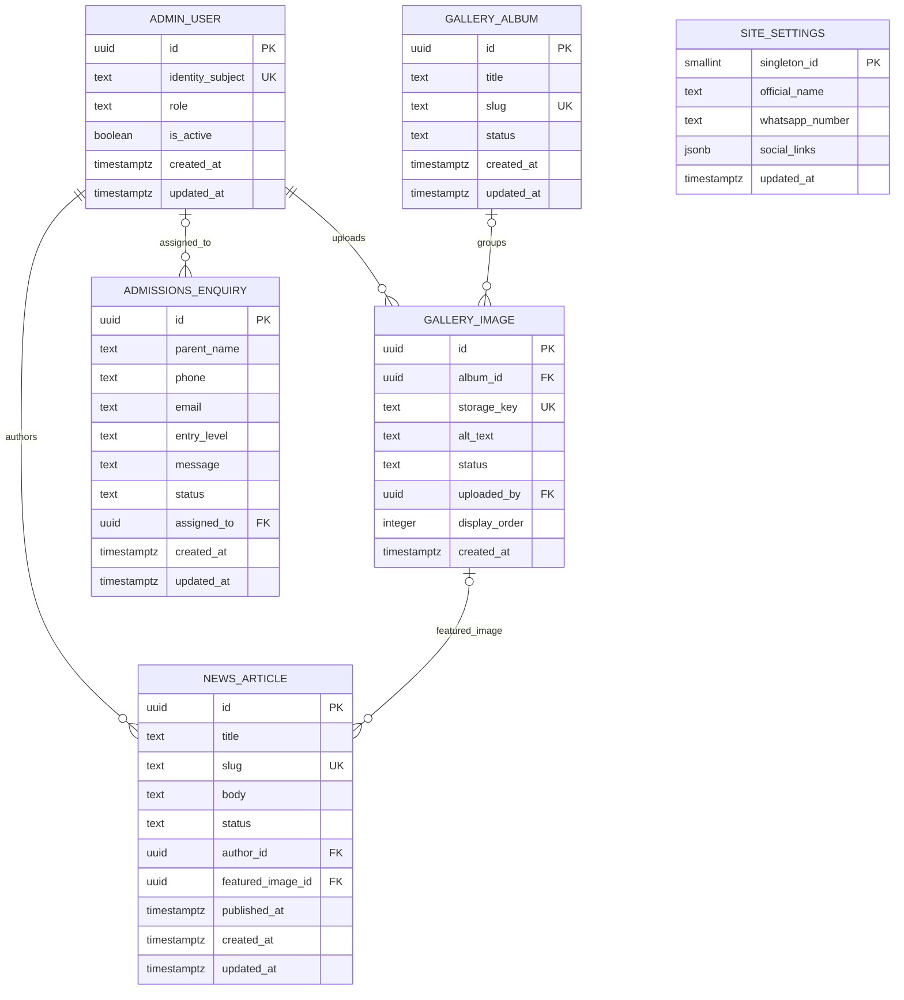

# Database Schema

**Status:** Approved logical schema for MVP implementation (PostgreSQL target + SQLite `node:sqlite` local execution adapter approved 2026-11-10)  
**Schema version:** Version 1.0 (2026-11-10; updated from Proposal 0)  
**Authority:** Product fields and behavior are governed by [`../prd.md`](../prd.md); data ownership and handling by [`data-architecture.md`](./data-architecture.md); system boundaries by [`architecture.md`](./architecture.md). Approved by Project Owner on 2026-11-10 alongside [ADR-002](./decisions/ADR-002-postgresql-data-platform.md), [`api-specification.md`](./api-specification.md), and [`security-specification.md`](./security-specification.md).

> **Owner Decisions Recorded (2026-11-10):**
> 1. **About & Academics Editable Content (`FIND-02`):** `site_settings` includes structured JSON fields `about_content` and `academics_content` (and `admissions_content`) with server-side schema validation so authorized administrators can edit About (`FR-02`) and Academics (`FR-03`) content without modifying source code.
> 2. **Enquiry Privacy & Entry Levels (`FIND-03`):** `admissions_enquiry` persists `privacy_acknowledged` (`boolean NOT NULL DEFAULT true`) and `idempotency_key` (`text UNIQUE NULL`), and enforces school-approved entry levels (`Day Care`, `KG 1`, `KG 2`, `Nursery 1`, `Nursery 2`, `Primary 1`–`Primary 5`, `JSS 1`–`JSS 3`, `SSS 1`–`SSS 3`).
> 3. **Student Media Approval (`FIND-04`):** `gallery_image` includes `school_approved` (`boolean NOT NULL DEFAULT false`), `identifiable_students` (`boolean NOT NULL DEFAULT false`), and `approval_reference` (`text NULL`). Images cannot transition to `published` unless `school_approved = true` (and `approval_reference` is present when `identifiable_students = true`).
> 4. **Admin Role Model (`FIND-05`):** Single MVP `role_code = 'administrator'` approved with server-side active-account (`is_active = true`) and per-operation permission enforcement.

## 1. Existing Schema and Scope

### Existing state

There is **no existing application schema**: no database, ORM models, SQL files, migrations, API specification, or source code were found. No live database was inspected or modified.

### Entities justified by current MVP requirements

This proposal includes only the entities named or required by the PRD:

1. `admin_user` — administrator identity/role reference (PRD §8.2 A; FR-09).
2. `news_article` — news and announcements (PRD §8.2 B; FR-06).
3. `gallery_album` — optional grouping for images (PRD §8.2 C; FR-07).
4. `gallery_image` — image metadata and storage reference; also supports article featured image (PRD §8.2 D; FR-06–FR-07).
5. `admissions_enquiry` — private public-form submissions (PRD §8.2 E; FR-04, FR-09).
6. `site_settings` — controlled approved public settings (PRD §8.2 F; FR-08–FR-09).

No separate category, role, consent-document, audit-event, analytics, queue, notification, search, vector, or content-version table is added because the current requirements do not establish its behavior or ownership. If approval evidence must be recorded, or additional workflows are approved, extend the schema through a reviewed change rather than silently relying on this proposal.

## 2. Conventions and Type Mapping

The types below are **PostgreSQL candidate types**, not a selected or provisioned database. If another database is approved, map semantics explicitly and document differences.

- Primary identifiers: `uuid`, generated by the database or application using an approved UUID generator.
- Times: `timestamptz`, stored as instants in UTC; display timezone and publication-local-time rules remain to be decided.
- Money: none; fees/payments are outside MVP.
- Enumerations: `text` with `CHECK` constraints in this proposal, avoiding database enum migration rigidity while allowed values are still evolving.
- JSON: `jsonb` only for bounded, structured configuration such as social links and brand colors; validate shape in application code. Do not use a JSON blob for enquiries or content entities that need relational integrity.
- Text: `text`; application-level maximum lengths must be set from UX/API contracts before implementation. Do not assume unlimited request payloads.
- Nullable fields are explicitly identified below. All other listed business fields are required unless noted.
- `created_at` defaults to the current database time; updates to `updated_at` must be maintained consistently by the application or a reviewed database mechanism.

## 3. Entity Relationship Diagram



There is deliberately no `updated_by` foreign key on the singleton settings proposal. Add actor attribution only if an approved audit/history requirement defines its retention and access controls.

## 4. Proposed Table Definitions

### 4.1 `admin_user`

**Purpose / owner:** Local authorization profile linked to an external identity if a provider is selected. Identity provider/account owner remains authoritative for authentication. School project owner controls access policy. Restricted security data.

| Field | Candidate type | Nullability / default | Constraints and meaning |
|---|---|---|---|
| `id` | `uuid` | `NOT NULL`, generated | Primary key. Internal, non-secret identifier. |
| `identity_subject` | `text` | `NOT NULL` | Stable subject/identifier from the selected identity mechanism; unique. Never store provider credentials or session tokens here. Provider namespace semantics must be confirmed. |
| `display_name` | `text` | `NOT NULL` | Admin display name; length validated at server boundary. |
| `email` | `text` | Nullable only if identity integration does not provide/require it; no implicit public exposure | Optional contact/display field. Normalize case/format consistently if used for lookup. |
| `role_code` | `text` | `NOT NULL` | Candidate MVP value `administrator`; enforce approved role values after role model decision. |
| `is_active` | `boolean` | `NOT NULL DEFAULT true` | Disabled accounts must fail authorization even if identity provider accepts authentication. |
| `created_at` | `timestamptz` | `NOT NULL DEFAULT now()` | Profile creation time. |
| `updated_at` | `timestamptz` | `NOT NULL DEFAULT now()` | Last profile/role/status change time. |
| `last_login_at` | `timestamptz` | Nullable | Optional PRD field; only store if an approved operational need exists. |

**Keys/indexes**

- PK: (`id`).
- Unique: (`identity_subject`). If multiple identity providers can coexist, uniqueness must include an approved provider identifier; provider is not selected.
- No email unique index unless the identity policy explicitly treats email as the canonical unique identity.
- No password or secret field in this proposal. If local passwords are later explicitly selected, store only an established password hash in a separately reviewed security design—never plaintext.

**Relationships:** referenced by `news_article.author_id`, `gallery_image.uploaded_by`, and optionally `admissions_enquiry.assigned_to`.

**Deletion:** `RESTRICT` deletion when referenced; disable (`is_active=false`) instead of deleting a user and losing attribution. Any personal-data erasure exception requires a school-approved policy and anonymization design.

**Requirements:** PRD §8.2 A, FR-09, NFR-04; audit AUD-04.

### 4.2 `news_article`

**Purpose / owner:** Authored school announcements and news. School/content approver is authoritative for facts and publication approval; this table owns current application content/publication state.

| Field | Candidate type | Nullability / default | Constraints and meaning |
|---|---|---|---|
| `id` | `uuid` | `NOT NULL`, generated | Primary key. |
| `title` | `text` | `NOT NULL` | Required article title. |
| `slug` | `text` | `NOT NULL` | Stable, readable public identifier; unique. Canonicalization rules are an API/application contract decision. |
| `excerpt` | `text` | Nullable | Optional summary. |
| `body` | `text` | `NOT NULL` | Rich text/source representation; treat as untrusted and sanitize on render or through a defined safe content pipeline. |
| `featured_image_id` | `uuid` | Nullable | Optional FK to `gallery_image.id`; only a published/approved image can be rendered publicly. |
| `status` | `text` | `NOT NULL DEFAULT 'draft'` | Candidate allowed set: `draft`, `published`, `unpublished`, `archived`. State-transition authorization and exact semantics require approval. |
| `published_at` | `timestamptz` | Nullable | Required when status is `published`; publication clock/timezone policy must be defined. |
| `author_id` | `uuid` | `NOT NULL` | FK to `admin_user.id`; author attribution. |
| `seo_title` | `text` | Nullable | Optional per-page title. |
| `seo_description` | `text` | Nullable | Optional per-page description. |
| `created_at` | `timestamptz` | `NOT NULL DEFAULT now()` | Creation timestamp. |
| `updated_at` | `timestamptz` | `NOT NULL DEFAULT now()` | Last successful content/status update. |

**Keys/indexes**

- PK: (`id`).
- Unique: (`slug`) for stable public lookup.
- Index: (`status`, `published_at DESC`) for published listing and dashboard status counts/listing. Confirm query shape when code exists.
- Index: (`author_id`) only if author-filtered dashboard queries are implemented; otherwise the FK alone does not justify an index.

**Constraints**

- `CHECK (status IN ('draft','published','unpublished','archived'))`.
- `CHECK (status <> 'published' OR published_at IS NOT NULL)`.
- Consider a constraint that non-published states clear or preserve `published_at` only after business definition; avoid imposing unspecified semantics.
- `featured_image_id` nullable FK; `ON DELETE RESTRICT` while referenced. Clear the reference or replace it through an authorized content update before deleting the image.
- `author_id` FK `ON DELETE RESTRICT`; deactivation does not delete history.

**Deletion:** Prefer status change/archive as supported by FR-06; hard-delete only under approved retention/permissions, after dependency checks. No soft-delete column is included because archive status already exists and a separate deletion/retention rule is not approved.

**Requirements:** PRD FR-06, FR-10, §8.2 B, §8.3, NFR-04, NFR-08; audit AUD-03, AUD-09, AUD-14.

### 4.3 `gallery_album`

**Purpose / owner:** Optional grouping for published gallery images. School/content approver owns whether content is accurate and approved; application owns grouping and current status.

| Field | Candidate type | Nullability / default | Constraints and meaning |
|---|---|---|---|
| `id` | `uuid` | `NOT NULL`, generated | Primary key. |
| `title` | `text` | `NOT NULL` | Required album title. |
| `slug` | `text` | `NOT NULL` | Unique readable identifier if album routes are exposed. If albums are not directly addressable, a slug may be unnecessary and should be removed before implementation. |
| `description` | `text` | Nullable | Optional description. |
| `status` | `text` | `NOT NULL DEFAULT 'draft'` | Candidate allowed set: `draft`, `published`, `unpublished`, `archived`; status semantics require approval. |
| `created_at` | `timestamptz` | `NOT NULL DEFAULT now()` | Creation timestamp. |
| `updated_at` | `timestamptz` | `NOT NULL DEFAULT now()` | Last content/status update. |

**Keys/indexes**

- PK: (`id`).
- Unique: (`slug`) only if route/addressability is confirmed.
- Index on `status` only if measured query patterns justify it; no index is proposed by default.

**Constraints and relationships**

- Status `CHECK` as above.
- `gallery_image.album_id` references album; `ON DELETE SET NULL` preserves images if a grouping is removed. If deletion is prohibited by policy, change to `RESTRICT`.
- Public album/gallery queries must require both the image and any parent album to be in a publishable state when album visibility governs image visibility; define this rule before implementing.

**Deletion:** no cascade to image bytes or images; archive/unpublish first. Retention and deletion approvals remain open.

**Requirements:** PRD FR-07, §8.2 C; audit AUD-09, AUD-10.

### 4.4 `gallery_image`

**Purpose / owner:** Metadata and object reference for school photographs. School owns the image and authorization to publish; storage owns bytes. Restricted until approved and published.

| Field | Candidate type | Nullability / default | Constraints and meaning |
|---|---|---|---|
| `id` | `uuid` | `NOT NULL`, generated | Primary key. |
| `album_id` | `uuid` | Nullable | FK to `gallery_album.id`; `ON DELETE SET NULL`. |
| `storage_key` | `text` | `NOT NULL` | Opaque object identifier, not a public URL or credential; unique within the selected storage namespace. If multiple buckets/providers exist, namespace must be part of the key or unique constraint. |
| `alt_text` | `text` | `NOT NULL` | Required accessible alternative text per FR-07. |
| `caption` | `text` | Nullable | Optional public caption. |
| `display_order` | `integer` | `NOT NULL DEFAULT 0` | Ordering within gallery/album; non-negative check. No uniqueness: equal positions may be resolved deterministically by `created_at`, then `id`. |
| `status` | `text` | `NOT NULL DEFAULT 'draft'` | Candidate allowed set: `draft`, `published`, `unpublished`, `archived`. Publication also requires the school approval precondition for identifiable student images. |
| `uploaded_by` | `uuid` | `NOT NULL` | FK to `admin_user.id`; `ON DELETE RESTRICT`. |
| `created_at` | `timestamptz` | `NOT NULL DEFAULT now()` | Upload/record creation time. |

**Keys/indexes**

- PK: (`id`).
- Unique: (`storage_key`) within the configured storage namespace.
- Index: (`status`, `display_order`, `created_at`) for published gallery ordering and admin status filtering.
- Index: (`album_id`, `status`, `display_order`) if album-filtered listing is implemented.
- Index `uploaded_by` only if admin queries commonly filter by uploader.

**Constraints**

- `CHECK (status IN ('draft','published','unpublished','archived'))`.
- `CHECK (display_order >= 0)`.
- An image may be referenced by an article only while the object exists and is publicly approved/published; enforce this in application publication logic, not only FK existence.
- Database row state and object-store state are not one transaction. Upload privately first; do not make a public reference on partial failure.

**Approval evidence:** The PRD requires school approval before publishing identifiable student photographs, but does not define whether approval evidence is stored in the application, what form it takes, or who records it. This proposal does **not** invent a consent/approval table or claim that `status='published'` proves permission. Before allowing student-identifying media, choose an approved workflow and add the minimum required evidence/reference fields or verify an authoritative external approval process.

**Deletion:** Remove public availability before deleting/replacing the object. Preserve or purge metadata/bytes according to approved retention and backup policy. No cascade delete is allowed from album, article, or uploader.

**Requirements:** PRD FR-06–FR-07, §8.2 D, NFR-04–NFR-05; audit AUD-06, AUD-09.

### 4.5 `admissions_enquiry`

**Purpose / owner:** Sole application record of a website admissions enquiry. School owns the response purpose and retention; access is restricted to authorized staff.

| Field | Candidate type | Nullability / default | Constraints and meaning |
|---|---|---|---|
| `id` | `uuid` | `NOT NULL`, generated | Primary key; never expose as a public identifier or include in public URLs. |
| `parent_name` | `text` | `NOT NULL` | Required contact name; server-side trim/length validation. |
| `phone` | `text` | `NOT NULL` | Required contact number, normalized consistently without losing required display/use semantics. |
| `email` | `text` | Nullable | Optional contact email; validate server-side. |
| `entry_level` | `text` | `NOT NULL` | Required school-approved option. Allowed values must come from an approved list; exact levels not established. |
| `message` | `text` | Nullable | Optional question; restrict length and treat as untrusted free text that may contain excess sensitive information. |
| `status` | `text` | `NOT NULL DEFAULT 'new'` | Allowed values `new`, `contacted`, `resolved`, `archived`. |
| `created_at` | `timestamptz` | `NOT NULL DEFAULT now()` | Submission timestamp; use consistently for recent/new views. |
| `updated_at` | `timestamptz` | `NOT NULL DEFAULT now()` | Last successful status/data update. |
| `assigned_to` | `uuid` | Nullable | Optional assignment per PRD; FK to `admin_user.id`, `ON DELETE SET NULL`. |

**Keys/indexes**

- PK: (`id`).
- Index: (`status`, `created_at DESC`) for new/recent dashboard lists and status counts.
- Index: (`created_at DESC`) only if a separate all-enquiries recent query is used; avoid duplicate index if the composite index serves the actual query.
- No index on `phone`, `email`, or `message` is proposed: no search/filter requirement justifies indexing these sensitive fields.

**Constraints**

- `CHECK (status IN ('new','contacted','resolved','archived'))`.
- `entry_level` must match currently approved entry-level values; options may be stored in controlled application config or modeled separately only if management requirements justify it. Do not encode guessed school levels.
- No uniqueness constraint on contact details: one parent may legitimately submit multiple enquiries. Duplicate-submission semantics are unresolved; implement no deduplication assumption.
- Assignment FK should reference an active admin at mutation time; a simple FK cannot enforce active status.
- Status transition rules (including archive/unarchive) are not specified; enforce the approved state machine in the application service once decided.

**Access / deletion:** Never expose in public queries, search index, analytics, URLs, or logs. Retention/deletion/anonymization and data-subject request handling require school approval before production collection. No soft-delete field is proposed until retention rules specify whether and why records must remain recoverable.

**Requirements:** PRD FR-04, FR-09, §6.3, §8.2 E, §8.3, NFR-04–NFR-06; audit AUD-05, AUD-07, AUD-09.

### 4.6 `site_settings`

**Purpose / owner:** Controlled school-approved public settings, editable by authorized staff as approved. School management is authoritative for values.

Proposed singleton row (`singleton_id = 1`) avoids creating an unrequested generic key/value settings system. Optional values are nullable until supplied and approved.

| Field | Candidate type | Nullability / default | Constraints and meaning |
|---|---|---|---|
| `singleton_id` | `smallint` | `NOT NULL DEFAULT 1` | Primary key plus `CHECK (singleton_id = 1)` to enforce one settings row. |
| `official_name` | `text` | Nullable until approved | Approved school display name. |
| `logo_storage_key` | `text` | Nullable | Opaque asset reference; may be removed in favor of a static app asset if no CMS logo management is approved. |
| `brand_colors` | `jsonb` | Nullable | Bounded JSON object of approved color tokens; validate schema and values in application layer. |
| `telephone` | `text` | Nullable | Approved contact phone. |
| `email` | `text` | Nullable | Approved public contact email. |
| `whatsapp_number` | `text` | Nullable | Validated international number; never substitute a guessed value. |
| `address` | `text` | Nullable | Publish only after school verification. |
| `office_hours` | `text` | Nullable | Approved public office hours, if supplied. |
| `social_links` | `jsonb` | `NOT NULL DEFAULT '[]'::jsonb` | Array of approved public links; validate URL schemes/hosts and shape. |
| `default_seo_title` | `text` | Nullable | Optional default metadata. |
| `default_seo_description` | `text` | Nullable | Optional default metadata. |
| `updated_at` | `timestamptz` | `NOT NULL DEFAULT now()` | Last settings update. |

**Keys/indexes and constraints**

- PK: (`singleton_id`); check value is `1`.
- No secondary index: this small single row is fetched by primary key.
- No infrastructure credentials, provider keys, privileged URLs, or general-purpose opaque secrets may be stored in this row.
- JSON shape, allowed link schemes, and value lengths must be validated by server-side application logic. Database JSON type alone does not validate business semantics.

**Audit/change history:** No history table is proposed because a retention/audit requirement is not approved. If historical values or approver attribution are required, add an approved audit design rather than silently retaining obsolete contacts.

**Requirements:** PRD FR-02, FR-03, FR-05, FR-08–FR-10, §8.2 F, §8.3, NFR-04; audit AUD-03, AUD-10, AUD-11.

## 5. Relationships and Referential Integrity

| Relationship | Cardinality | Proposed delete/update behavior |
|---|---|---|
| `admin_user` → `news_article.author_id` | One admin authors many articles | `ON DELETE RESTRICT`; deactivate user instead. PK updates are disallowed; UUIDs are immutable. |
| `admin_user` → `gallery_image.uploaded_by` | One admin uploads many images | `ON DELETE RESTRICT`; preserve attribution. |
| `admin_user` → `admissions_enquiry.assigned_to` | One admin may handle many enquiries; enquiry may be unassigned | `ON DELETE SET NULL`; preserve enquiry if staff account is removed under approved policy. |
| `gallery_album` → `gallery_image.album_id` | Album optionally groups many images | `ON DELETE SET NULL` in this proposal; images and objects are not deleted with an album. Confirm whether policy instead requires `RESTRICT`. |
| `gallery_image` → `news_article.featured_image_id` | An image may be used by multiple articles; article image optional | `ON DELETE RESTRICT`; clear/replace references through authorized content updates before image deletion. |
| `site_settings` | One singleton row, no required entity FK | No relationships. Any `updated_by`/approval reference requires approved audit and role policy. |

All primary keys are immutable. Changes to reference data such as role codes, status values, slugs, and storage keys use application workflows and reviewed migrations where schema changes are involved. A slug change must not silently break a published URL; redirect/canonical behavior remains undecided.

## 6. Transactions and Data Consistency

- **Enquiry create:** One database transaction creates the enquiry and any required database-side related data. Return success only after commit. No notification participates in the transaction; optional future notification failure must not remove the enquiry.
- **Enquiry status/assignment:** Validate authorization and status transition, then update status/assignment and `updated_at` atomically. No audit-event record is included until the school decides whether a history log is required.
- **Article publish:** Validate required fields, slug uniqueness, author, allowed status transition, and featured image eligibility; update content/status/publication time in one database transaction. A database FK cannot prove media permission or object availability.
- **Album/image publication:** Persist metadata/status atomically in the database, but object storage is a separate system with no assumed distributed transaction. Upload into private storage first; expose only after object validation, approval, and publication succeed. Failures must leave the image unavailable publicly; clean up orphan objects under a reviewed process.
- **Settings update:** Validate all submitted settings before updating the singleton row; update as one atomic statement/transaction.
- **Retries:** Do not blindly retry writes. Enquiry idempotency/duplicate handling is open. Do not imply exactly-once behavior from a database transaction.

## 7. Index Rationale

Indexes above are based only on PRD query requirements, not benchmark claims:

- Unique slug indexes support public article/album lookup and integrity.
- `(status, published_at DESC)` supports published-news listing and status-filtered dashboard views.
- `(status, created_at DESC)` supports the dashboard's “new/recent enquiries” and status filtering.
- `(album_id, status, display_order)` is conditional on album-based gallery filtering being implemented.
- `storage_key` uniqueness prevents the same object key from being assigned to multiple image records in the chosen namespace.
- No indexes are proposed for enquiry names, phone, email, message, or SEO metadata because no search requirements justify indexing private or low-selectivity fields.
- Revisit index choices with actual query plans and workload evidence after the implementation exists. Avoid adding indexes without a query/use-case or integrity reason.

## 8. Sensitive Data and Access Restrictions

| Data | Classification / handling |
|---|---|
| Enquiry name, phone, email, message, assignment | Restricted personal information. Only authorized admin/admissions roles may read; all writes are server-authorized. Exclude from public APIs, search, URLs, logs, analytics, and AI tools. Retention policy is a pre-production approval gate. |
| Admin identity subject, email, active state, role | Restricted security/account data. No credentials or session tokens in application tables. Enforce active status and role server-side. |
| Student image bytes and identifying metadata | Restricted until school approval; if published, treat as public disclosure. Approval evidence and withdrawal policy are unresolved; do not publish identifiable media without school authorization. |
| Draft/pending school copy, unpublished news/images | Restricted to authorized admin; never publicly indexable. |
| Published school facts, contact details, public captions | Public only after verification/approval. |
| `storage_key` and secret/config values | Storage key is an opaque reference, not a credential. Actual credentials belong in protected runtime configuration, never the database settings row. |
| Backups | At least as sensitive as source records; restrict access, protect copies, define region/retention, and test restore. |

Database roles, row-level policies (if a provider/API architecture requires them), encryption at rest, key management, network controls, log retention, and incident handling require the final provider/security specification. Application authorization remains mandatory even if database-level policies are also used.

## 9. Schema Evolution and Migration

No migration has been created or run. When approved:

1. Commit each schema change as a reviewed, versioned migration; never make untracked production schema edits.
2. Validate forward migration and expected constraints against a disposable test database and representative synthetic fixtures.
3. Test application compatibility with the schema version during deploy overlap. Use expand/contract for changes requiring old and new application versions to coexist.
4. Treat destructive changes, data transformations, enum/status removals, and column drops as non-automatically reversible. Require an approved backup, data validation, rollback/forward-recovery plan, and owner sign-off.
5. Do not run irreversible migrations until data retention, backups, RTO/RPO, and restore owner have been approved.
6. Verify indexes and query plans after real query patterns are known; no performance benchmarks are available.
7. Test a database and media restore together where media integrity depends on storage references. A database-only restore may point to missing objects or omit later objects.

## 10. Candidate Schema DDL (Illustrative Only)

The field tables above are the normative logical proposal. This abbreviated DDL is **not executable deployment guidance** and omits the unresolved constraints and policies called out above:

```sql
-- Illustrative PostgreSQL candidate only. Not a migration.
CREATE TABLE admin_user (
  id uuid PRIMARY KEY,
  identity_subject text NOT NULL UNIQUE,
  display_name text NOT NULL,
  email text,
  role_code text NOT NULL,
  is_active boolean NOT NULL DEFAULT true,
  created_at timestamptz NOT NULL DEFAULT now(),
  updated_at timestamptz NOT NULL DEFAULT now(),
  last_login_at timestamptz
);

CREATE TABLE gallery_album (
  id uuid PRIMARY KEY,
  title text NOT NULL,
  slug text NOT NULL UNIQUE,
  description text,
  status text NOT NULL DEFAULT 'draft'
    CHECK (status IN ('draft', 'published', 'unpublished', 'archived')),
  created_at timestamptz NOT NULL DEFAULT now(),
  updated_at timestamptz NOT NULL DEFAULT now()
);

CREATE TABLE gallery_image (
  id uuid PRIMARY KEY,
  album_id uuid REFERENCES gallery_album(id) ON DELETE SET NULL,
  storage_key text NOT NULL UNIQUE,
  alt_text text NOT NULL,
  caption text,
  display_order integer NOT NULL DEFAULT 0 CHECK (display_order >= 0),
  status text NOT NULL DEFAULT 'draft'
    CHECK (status IN ('draft', 'published', 'unpublished', 'archived')),
  uploaded_by uuid NOT NULL REFERENCES admin_user(id) ON DELETE RESTRICT,
  created_at timestamptz NOT NULL DEFAULT now()
);

CREATE TABLE news_article (
  id uuid PRIMARY KEY,
  title text NOT NULL,
  slug text NOT NULL UNIQUE,
  excerpt text,
  body text NOT NULL,
  featured_image_id uuid REFERENCES gallery_image(id) ON DELETE RESTRICT,
  status text NOT NULL DEFAULT 'draft'
    CHECK (status IN ('draft', 'published', 'unpublished', 'archived')),
  published_at timestamptz,
  author_id uuid NOT NULL REFERENCES admin_user(id) ON DELETE RESTRICT,
  seo_title text,
  seo_description text,
  created_at timestamptz NOT NULL DEFAULT now(),
  updated_at timestamptz NOT NULL DEFAULT now(),
  CHECK (status <> 'published' OR published_at IS NOT NULL)
);

CREATE TABLE admissions_enquiry (
  id uuid PRIMARY KEY,
  parent_name text NOT NULL,
  phone text NOT NULL,
  email text,
  entry_level text NOT NULL,
  message text,
  status text NOT NULL DEFAULT 'new'
    CHECK (status IN ('new', 'contacted', 'resolved', 'archived')),
  created_at timestamptz NOT NULL DEFAULT now(),
  updated_at timestamptz NOT NULL DEFAULT now(),
  assigned_to uuid REFERENCES admin_user(id) ON DELETE SET NULL
);

CREATE TABLE site_settings (
  singleton_id smallint PRIMARY KEY DEFAULT 1 CHECK (singleton_id = 1),
  official_name text,
  logo_storage_key text,
  brand_colors jsonb,
  telephone text,
  email text,
  whatsapp_number text,
  address text,
  office_hours text,
  social_links jsonb NOT NULL DEFAULT '[]'::jsonb,
  default_seo_title text,
  default_seo_description text,
  updated_at timestamptz NOT NULL DEFAULT now()
);

CREATE INDEX news_article_status_published_at_idx
  ON news_article (status, published_at DESC);
CREATE INDEX admissions_enquiry_status_created_at_idx
  ON admissions_enquiry (status, created_at DESC);
CREATE INDEX gallery_image_status_order_created_at_idx
  ON gallery_image (status, display_order, created_at);
```

DDL gaps to resolve before migration: role-code allowed set; public-entry-level validation source; image approval evidence; album route requirement and publication inheritance; `storage_key` namespace; active-account assignment constraint; text/request bounds; slug normalization/redirect policy; JSON validation; retention/deletion; audit history; and exact index necessity. Do not copy this block directly into production.

## 11. Consistency with APIs and Security Specifications

- An API proposal and [`security-specification.md`](./security-specification.md) are present, but neither is an approved contract/baseline: the security specification is reference-only pending formal approval. Request and data access behavior must be reconciled with approved contracts and policy before implementation.
- Public read operations must expose explicit field projections. Database entities are not API response models.
- Server-side validation and authorization are mandatory; database constraints are a second integrity layer.
- No direct public database access is assumed. If the eventual platform exposes database APIs to clients, the architecture and ADR must be revised and database-level access policies independently specified and tested.
- Enquiry messages are untrusted free text; sanitize/escape at rendering boundaries and do not assume storage sanitization makes output safe.
- Rich text and uploaded images require separate validation/rendering controls; constraints here do not replace security controls.
- The candidate `identity_subject` is not an authentication credential. Do not persist passwords, OAuth tokens, API keys, or session secrets in these tables.

## 12. Open Schema Decisions

Obtain approval before finalizing or implementing this proposal:

1. Accept/reject PostgreSQL direction and select provider, region, supported version, connection model, and data-access layer (ADR-002 Proposed).
2. Approve administrator identity and role model, identity subject uniqueness, account lifecycle, and whether an audit history is required (ADR-003 Proposed; audit AUD-04).
3. Confirm exact editable public content and whether `site_settings` is a singleton, structured CMS page model, or a mixture (audit AUD-10).
4. Define publication states and transitions, author/approver separation, approval evidence, and which actions require school-management approval (audit AUD-03, AUD-06, AUD-09).
5. Define approved entry-level values and whether they should be a controlled table rather than application configuration.
6. Decide whether album routes exist and whether deleting an album should detach or restrict images.
7. Approve retention, deletion/anonymization, export, access/correction requests, and legal/operational exceptions for enquiries and media (audit AUD-05–AUD-06).
8. Define enquiry duplicate/idempotency and retry behavior (audit AUD-07).
9. Define timezone, future/scheduled publication, slug-change redirects, and content history (audit AUD-09, AUD-14).
10. Define expected query/data/media volumes, cache freshness, backup coverage, retention, RTO/RPO, and recovery owner (audit AUD-12, AUD-17).

No existing schema was changed, no database was accessed, and no migration was run.
